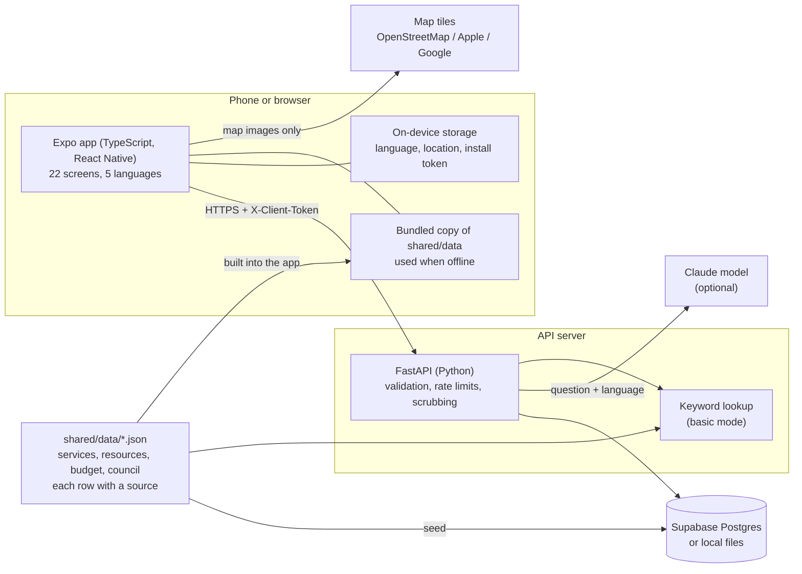

# Technical overview

How ReSource is put together, written so you can explain it out loud. File paths are given so you can open the code behind each sentence.

## In one paragraph

ReSource is one app written in TypeScript with React Native and Expo, which builds a website, an iOS app and an Android app from the same code. It talks to an API written in Python with FastAPI. The API reads and writes a Postgres database hosted by Supabase, or plain files on disk when no database is set up. A chat question goes from the API to a Claude model with the app's own data attached, or is answered by a keyword lookup when there is no model. The facts about the city are JSON files in `shared/data/`, each row with its source.

## Diagram

## The parts

**The app (`app/`).** Screens live in `app/src/app/(tabs)/`, one file per screen; Expo Router turns each file into a route. Shared pieces (buttons, cards, the map, the consent boxes) are in `app/src/components/`. Text is never written into a screen: every string is looked up by key in `app/src/locales/<language>.json`. State that outlives a screen (language, location, saved resources) is in small stores in `app/src/state/stores.ts`. All network calls go through `app/src/lib/api.ts`.

**The API (`backend/`).** `main.py` starts FastAPI. Routes are grouped in `backend/routers/`: `public.py` (read-only data and counts), `contribute.py` (reports, posts, votes), `account.py` (alerts, export, delete), `admin.py` (moderation) and `chat.py`. `schemas.py` defines exactly what each request may contain; anything else is rejected. `security.py` handles identity and rate limits. `store.py` hides whether data lives in Supabase or in local files.

**The data (`shared/data/`).** Eleven services, fourteen resources, six alerts, the budget figures, the council roster. Each row has `source_url` and `retrieved`. The same files are built into the app (for offline use) and loaded into the database (`backend/database/seed.sql`).

**The database (`backend/database/`).** Twelve tables. `schema.sql` creates them, `rls_policies.sql` locks them down, `seed.sql` loads the data.

## What happens when someone files a report

1. The app checks the form, then sends `POST /reports` with a header `X-Client-Token`, a random value created on the device the first time it is needed.
2. `schemas.py` validates the body: allowed fields only, length limits, consent and age boxes ticked.
3. `security.py` turns the token into an owner id with an HMAC, a keyed hash using a secret only the server has. The token itself is never stored.
4. A rate limit is checked.
5. `moderation.py` removes emails, phone numbers and street addresses from the description.
6. The row is saved with status `pending`.
7. An admin later marks it `verified`. Only then does it count in the public totals.

## What happens when someone asks a question

1. The app sends the question and the chosen language to `POST /chat/stream`.
2. If an API key is set and the daily token budget is not spent, the API sends the question to Claude Sonnet 5 with a system prompt of rules (`RULES` in `grounding.py`). The prompt does not contain the app's data: Claude answers from its own knowledge, is told to flag Fremont-specific facts and point to the sourced Budget and Resources tabs, and can be wrong. If the answer is about Fremont and contains a phone number or street address not in the app's data, step 3 runs instead (`answer_validation.py`).
3. Otherwise, or if the Claude call fails, `grounding.local_answer` (basic search) matches words in the question against keyword lists for each category, in five languages, and returns the matching rows with their names as sources.
4. The app shows the answer and a label, "Claude AI" or "Basic search". Basic search answers list their sources; Claude answers show "Sources: none" because they do not come from the app's sourced data.

## What happens with no connection

`app/src/hooks/useData.ts` tries the API first. If that fails and the screen has a bundled copy, it shows the copy and a banner says so. When the connection returns, the screens reload.

## How "What changed for me?" works

`app/src/utils/forMe.ts` is about 60 lines of logic. Each interest maps to service categories (for example Parks to `parks`, Kids to `youth`). The function filters the services to those categories, splits them into changed (status not `open`) and unchanged, puts ones in the person's ZIP area first, and adds matching resources. It writes no sentences of its own, so it cannot state anything that is not in the data. The printed card is plain HTML built from the same result.

## How the project is checked

| Check | Command | What it proves |
| --- | --- | --- |
| Types and lint | `npm run typecheck`, `npm run lint` | The code is consistent |
| Translations | `npm run check:i18n` | All five languages have the same 620 keys |
| Contrast, alt text | `npm run check:contrast`, `check:alt` | Colors meet WCAG AA; images are labeled |
| Storage | `npm run check:storage` | Only one file touches device storage; no tracking packages |
| Claims | `npm run check:claims` | No unsupported statements in the app or these documents |
| Unit tests | `npm test` | 17 tests of the pure logic |
| End-to-end | `npm run e2e` | 44 tests drive the real web build against the real API, including an accessibility scan of every screen |
| API | `python -m pytest` in `backend/` | 138 tests |

## Numbers

About 11,600 lines of source across the app, API, scraper and shared types, not counting data and translations. 22 routes. 620 strings in each of 5 languages.

## What to be ready to say you did not do

Read `AI_DISCLOSURE.md`. Most of this code was written by AI coding agents under your direction. Judges will respect a clear account of what you decided and what you understand far more than a claim that does not hold up to one follow-up question.
